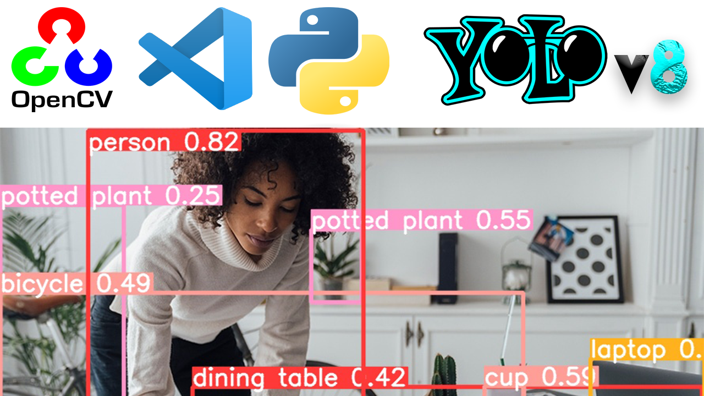
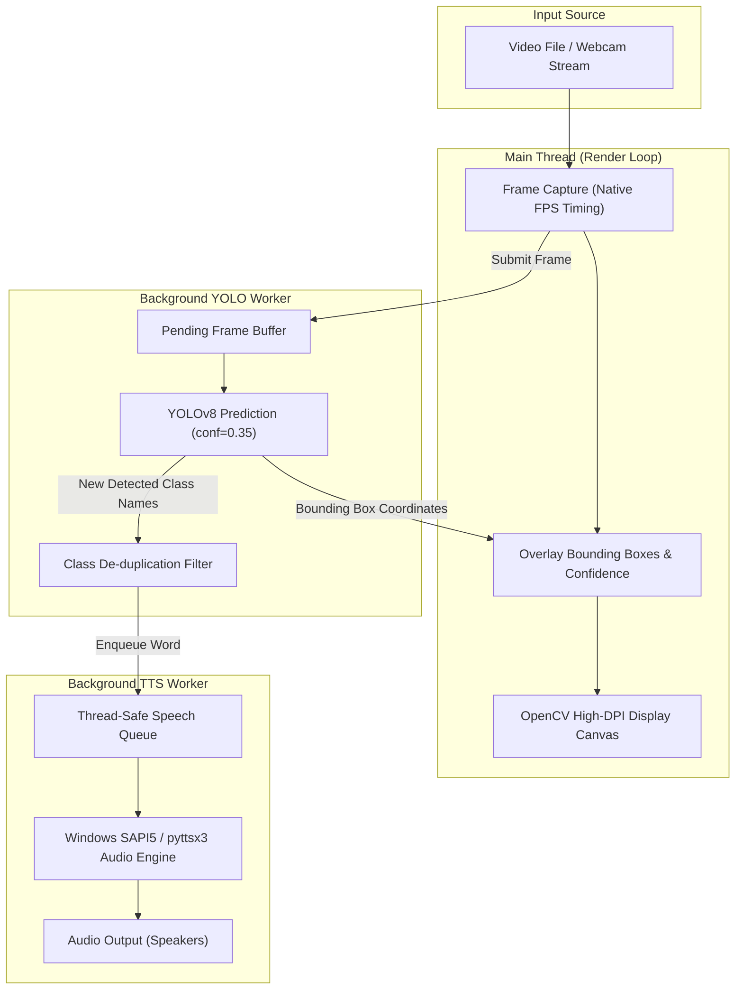

# 👁️ YOLOv8 Real-Time Object Detection with Voice Feedback



[](https://www.python.org/)
[](https://github.com/ultralytics/ultralytics)
[](https://opencv.org/)
[](https://pyttsx3.readthedocs.io/)
[](https://github.com/CodeXPandaa/yolov8-object-detection)

An intelligent, multi-threaded computer vision pipeline combining **Ultralytics YOLOv8** real-time object detection with **asynchronous text-to-speech (TTS)** feedback and a DPI-aware, high-performance display engine.

---

## ⚡ Key Highlights

- 🚀 **Asynchronous Multi-Threaded Pipeline**: Decouples video playback from deep learning inference. Videos run at **100% native FPS** without frame dropping or audio stutter.
- 🗣️ **Real-Time Voice Announcements**: Detected objects are automatically voiced via a dedicated background speech thread.
- 🧠 **Smart Speech De-duplication**: Tracks already-announced classes to prevent repetitive voice spamming while maintaining responsive feedback for newly introduced objects.
- 🖥️ **High-DPI Adaptive Window Management**: 
  - Automatically queries monitor resolution with Windows DPI awareness.
  - Aspect-ratio-preserving, resizable canvas (`WINDOW_NORMAL` + `WINDOW_KEEPRATIO`).
  - Auto-maximizes on start while preserving native window controls.
  - Pauses frame processing gracefully when minimized.
  - Clean exit via keyboard shortcuts (`Q`, `ESC`) or standard window close (`X`).
- 🎯 **State-of-the-Art Accuracy**: Powered by Ultralytics YOLOv8 trained on the COCO dataset (80 object classes). Supports custom trained `.pt` checkpoints.
- 📹 **Multi-Source Ready**: Effortlessly switch between pre-recorded video files, live webcam feeds, or static image inference.

---

## 🏗️ Architecture Overview



---

## 📂 Project Structure

```plaintext
yolov8-object-detection/
├── inference/
│   ├── banner.png           # Project banner image
│   ├── images/              # Sample images for testing (bird, cat, etc.)
│   └── videos/              # Test video footage (e.g., test 1.mp4, abhi.mp4)
├── utils/
│   └── coco.txt             # 80 COCO dataset class labels
├── weights/
│   ├── read.txt             # Model checkpoint storage guidelines
│   └── yolov8n.pt           # YOLOv8 nano pre-trained weights
├── .gitignore               # Git ignore rules
├── main.py                  # Primary application (Multi-threaded YOLO + TTS + GUI)
├── requirements.txt         # Project dependencies
├── yolo_check_system.py     # System environment & CUDA verification utility
└── yolov8_basics.py         # Static image detection starter script
```

---

## 🛠️ Installation & Setup

### 1. Prerequisites
- **Python 3.8** or newer installed.
- **Git** installed on your system.
- *(Optional)* NVIDIA GPU with CUDA support for accelerated inference.

### 2. Clone the Repository
```bash
git clone https://github.com/CodeXPandaa/yolov8-object-detection.git
cd yolov8-object-detection
```

### 3. Create and Activate a Virtual Environment

**Windows (PowerShell):**
```powershell
python -m venv .venv
.\.venv\Scripts\Activate.ps1
```

**macOS / Linux:**
```bash
python3 -m venv .venv
source .venv/bin/activate
```

### 4. Install Dependencies
```bash
pip install --upgrade pip
pip install -r requirements.txt
```

> **Note for Windows Users:** The `pywin32` package included in `requirements.txt` enables direct Windows SAPI5 audio dispatch for ultra-reliable speech without COM event loop deadlocks.

---

## 🚀 Running the Application

### Real-Time Video Object Detection with Speech
To start real-time detection on the default video:
```bash
python main.py
```

### Static Image Detection
To test YOLOv8 detection on an image from `inference/images/`:
```bash
python yolov8_basics.py
```

### Verify System & GPU Support
To inspect your PyTorch and Ultralytics hardware acceleration status:
```bash
python yolo_check_system.py
```

---

## ⚙️ Customization & Settings

Open `main.py` in your code editor to easily customize key settings:

### 1. Switch Video Source or Use Live Webcam
Change line 63-67 in `main.py`:

```python
# --- For pre-recorded video ---
video_path = BASE_DIR / "inference" / "videos" / "your_video.mp4"
cap = cv2.VideoCapture(str(video_path))

# --- For live webcam ---
# cap = cv2.VideoCapture(0)  # Use 0 for default internal webcam, 1 for external
```

### 2. Adjust Model Weights
By default, the script loads `weights/yolov8n.pt` (Nano model). You can swap it for any larger pre-trained model or a custom trained model:
```python
# Options: 'yolov8n.pt', 'yolov8s.pt', 'yolov8m.pt', 'yolov8l.pt', 'yolov8x.pt'
weights_path = BASE_DIR / "weights" / "yolov8m.pt"
model = YOLO(str(weights_path) if weights_path.is_file() else "yolov8m.pt", "v8")
```

### 3. Adjust Detection Confidence
Tune the confidence threshold in line 188 of `main.py`:
```python
results = model.predict(
    source=[frame_to_process],
    conf=0.40,      # Adjust between 0.10 (sensitive) and 0.90 (strict)
    imgsz=640,
    verbose=False,
    save=False,
)
```

### 4. Modify Speech Rate
On Windows, adjust the SAPI voice speed (line 88 in `main.py`):
```python
sapi_voice.Rate = 2  # Range: -10 (slowest) to +10 (fastest). Default: 2
```

---

## ⌨️ Controls & Shortcuts

| Action | Control | Description |
| :--- | :--- | :--- |
| **Quit** | `Q`, `q`, or `ESC` | Safely terminates threads, releases video streams, and exits. |
| **Close Window** | Click `✕` (Close) | Intercepts window destruction and cleanly terminates the process. |
| **Minimize** | Click `—` (Minimize) | Pauses frame rendering while minimized to conserve CPU/GPU resources. |
| **Resize** | Drag Window Borders | Window resizes dynamically while locking the original video aspect ratio. |

---

## ❓ Troubleshooting

<details>
<summary><b>1. No sound / Speech feedback is not playing?</b></summary>
<br>
- <b>Windows:</b> Ensure your speakers/headphones are set as default audio output. Verify <code>pywin32</code> is installed (<code>pip install pywin32</code>).<br>
- <b>Linux:</b> Install <code>espeak</code> and <code>ffmpeg</code>:<br>
  <code>sudo apt update && sudo apt install -y espeak ffmpeg libespeak1</code><br>
- <b>macOS:</b> Built-in <code>nsss</code> driver is supported automatically via <code>pyttsx3</code>.
</details>

<details>
<summary><b>2. Video does not open or shows "Cannot open video source"?</b></summary>
<br>
Verify the video filename and path inside <code>inference/videos/</code>. Ensure standard codecs (H.264, MP4). If using a webcam, check that privacy settings allow camera access and change <code>VideoCapture(0)</code> to <code>VideoCapture(1)</code> if an external camera is used.
</details>

<details>
<summary><b>3. Model runs slowly on CPU?</b></summary>
<br>
- Use the lightweight nano model (<code>yolov8n.pt</code>).<br>
- If you have an NVIDIA GPU, install CUDA-enabled PyTorch by following instructions at <a href="https://pytorch.org/get-started/locally/">pytorch.org</a>.
</details>

---

## 🤝 Contributing

Contributions, issues, and feature requests are welcome!
Feel free to open an issue or submit a pull request:

1. Fork the Project
2. Create your Feature Branch (`git checkout -b feature/AmazingFeature`)
3. Commit your Changes (`git commit -m 'feat: add some amazing feature'`)
4. Push to the Branch (`git push origin feature/AmazingFeature`)
5. Open a Pull Request

---

## 📄 License & Credits

Distributed under the MIT License. See `LICENSE` for more information.

Special thanks to:
- [Ultralytics YOLOv8](https://github.com/ultralytics/ultralytics) for the deep learning vision architecture.
- [OpenCV](https://opencv.org/) for high-performance computer vision tooling.
- [pyttsx3](https://github.com/nateshmbhat/pyttsx3) for cross-platform offline text-to-speech.